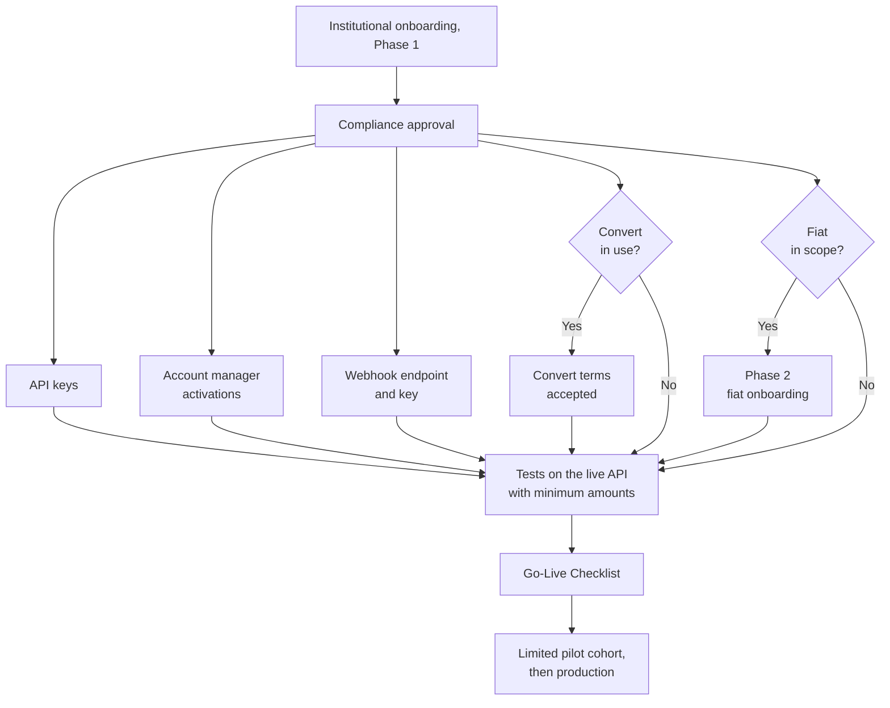
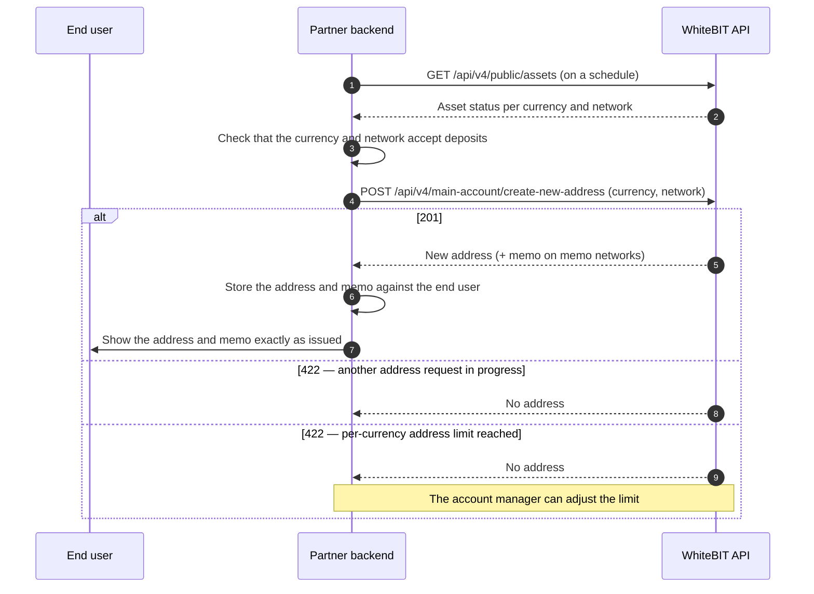
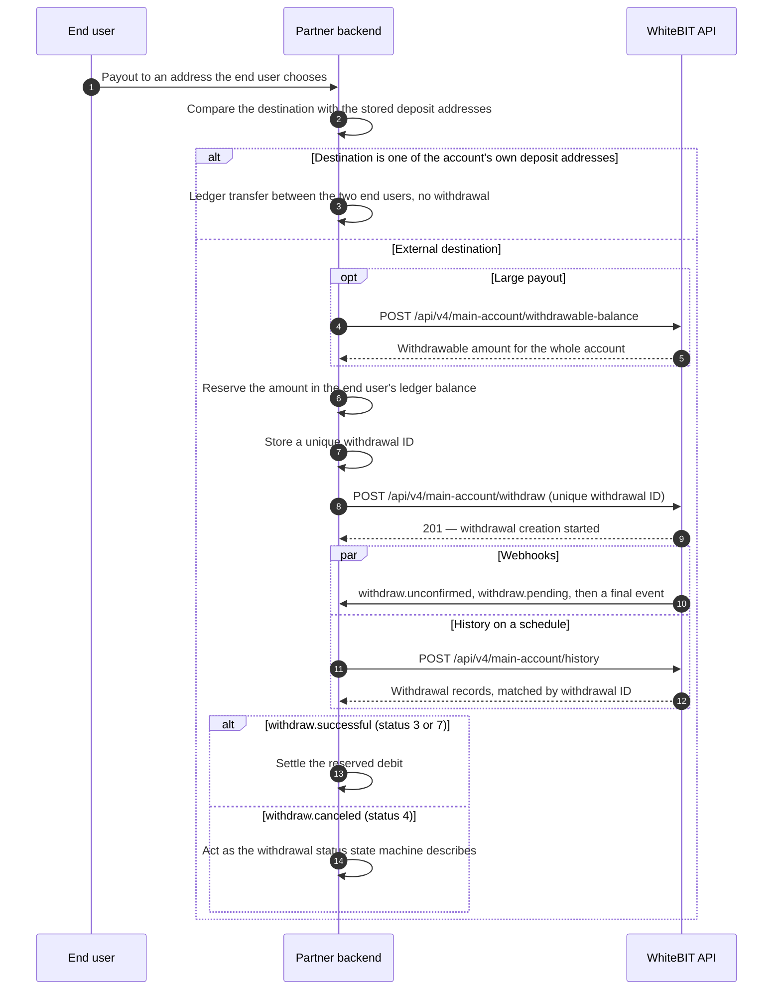
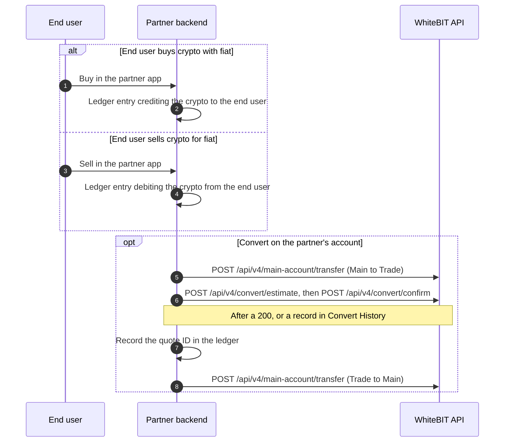

import { RegionBaseUrl } from '/snippets/RegionBaseUrl.jsx';
import TravelRuleNote from '/snippets/travel-rule-note.mdx';
import EuOnboarding from '/snippets/eu-onboarding.mdx';

<Note>
**For developers.** This page covers the technical integration. For what CaaS is, the segments it fits,
and the path to launch, see the [CaaS overview](/guides/caas-overview).
</Note>

A CaaS integration runs on the partner's own WhiteBIT account. The partner issues a deposit address per
end user, keeps an end-user ledger, credits end users from deposit events, and pays out from the account.
[Integration models](/concepts/integration-models#partners-own-account) compares this arrangement with
sub-accounts and with customers' own accounts.

<RegionBaseUrl />

## Prerequisites

- **Institutional onboarding** — KYB of the company and KYC of the director or responsible person,
  completed before provisioning. The main account accepts crypto deposits after onboarding. See
  [Institutional Onboarding](/institutional/onboarding).
- **API keys** — created after two-factor authentication is enabled; WhiteBIT recommends restricting each key
  to the endpoints and IPs the integration uses. See [Authentication](/api-reference/authentication).
- **Per-user deposit addresses** — `create-new-address` is not available by default; the account
  manager enables it on request. See [Unique address per user](/guides/payment-integration#unique-address-per-user).
- **Convert terms** — before the first conversion, the account owner accepts the Convert terms once on
  whitebit.com. See [Convert](/platform/convert).
- **Webhooks** — a webhook endpoint set up for the account, with the webhook key that verifies every
  delivery. See [Webhooks](/platform/webhook#how-to-use).
- **Fiat** — available only after fiat onboarding (Phase 2). See the
  [On/Off-Ramp guide](/guides/on-off-ramp-integration).
- **Other activations** — the account manager handles any other activation the account needs.

The diagram shows how the prerequisites lead from institutional onboarding to go-live.

## Architecture alignment during onboarding

The items below are agreed and documented with WhiteBIT during onboarding, before development starts.

- **End-user account mapping** — how end users map to deposit addresses and to the partner's end-user
  ledger. A sub-account per end user is a different arrangement — see
  [Other account arrangements](#other-account-arrangements).
- **Verification split** — the partner verifies its own end users; WhiteBIT verifies the partner during
  institutional onboarding (KYB).

  <EuOnboarding />
- **Data residency and privacy** — where end-user data is processed and stored, and the Data Processing
  Agreement (available via compliance@whitebit.com).
- **Operational roles** — which staff hold which permissions (API key scopes, withdrawal approval).
- **Support model** — support tiers, response targets, and incident channels beyond the public
  status page.
- **Fee and settlement terms.**

## Integration building blocks

### Core API access

- **REST and WebSocket.** Authenticated REST endpoints, WebSocket market data, and private account
  streams; every private request is signed. See [First API Call](/guides/first-api-call) and
  [Authentication](/api-reference/authentication).
  [Order placement, modification, and cancellation](/websocket/order-management/overview) over WebSocket
  are available on the global platform only, authorized once on the connection rather than per request.
- **SDKs and tooling.** Official SDKs, an MCP server, and a CLI for AI-assisted integration. See
  [SDKs](/sdks) and [AI tools](/guides/use-with-ai).
- **API keys.** The secret is shown only once, and inactive keys are deactivated. See
  [Authentication](/api-reference/authentication) and [First API Call](/guides/first-api-call) for the
  rules.
- **Rate limits.** Limits are set per scope and per endpoint. See
  [Rate limits](/api-reference/rate-limits) for current values rather than assuming a single figure.

<Warning>
API keys grant account access. Restrict each key to the minimum scope and to known IPs, and store
secrets outside application code. See [Authentication](/api-reference/authentication).
</Warning>

### Address issuance and end-user mapping

Each end user gets a deposit address per currency and network, and the partner keeps the mapping in its
own database.

1. Prefetch the currencies, networks, memo rules, deposit limits, and confirmation thresholds from
   [Asset Status](/api-reference/market-data/asset-status-list), and refresh the data on a schedule.
1. Request an address with `POST /api/v4/main-account/create-new-address`.
   The endpoint is not available by default; the account manager enables it on request — see
   [Create new address for deposit](/api-reference/account-wallet/create-new-address-for-deposit). Each call creates a new address — even when the last one is unused — within a per-currency
   address limit. The account manager can discuss and adjust the limit for the account.
1. Store the address — and its memo on memo networks — against the end user before showing it, and show
   the memo exactly as issued. See [Unique address per user](/guides/payment-integration#unique-address-per-user).

The sequence below issues an address to one end user. Deposits to the address then follow the
[per-end-user deposit address use case](/guides/payment-integration#use-cases).

### Deposits and crediting

- **Progress and completion.** `deposit.accepted` and `deposit.updated` report progress only; credit the
  end user when `deposit.processed` arrives or the history shows the deposit as successful. Verify every delivery with the webhook key. See
  [Deposit lifecycle](/guides/payment-integration#deposit-lifecycle) and
  [Webhooks](/platform/webhook#whitebit-deposit-to-main-balance).
- **Matching.** Match each credited deposit to an end user by its address — plus the memo on memo networks —
  and record it once, whether it arrives by webhook or by polling. See
  [Webhook reconciliation](/guides/payment-integration#webhook-reconciliation).
- **Held funds.** Part of a new deposit can stay held until the network fully confirms it. Held funds can
  be traded but not withdrawn, and
  [Withdrawable balance](/api-reference/account-wallet/withdrawable-balance) reports the hold for the
  whole account, not for each end user.
- **Unmatched deposits.** Route a deposit that matches no stored address and memo to manual review.
- **Refunds.** A canceled deposit may be refundable to an external address the end user provides. See
  [Refund flow](/guides/payment-integration#refund-flow).

### Travel Rule holds on deposits

Travel Rule affects deposits and withdrawals for EEA and Turkey accounts. Inbound crypto deposits to
those accounts are held until Travel Rule verification completes, and no webhook reports these status
changes: poll the history for the held statuses. See
[Travel Rule (EEA and Turkey)](/guides/payment-integration#travel-rule-eea-and-turkey) and
[Travel Rule deposit statuses](/platform/webhook#travel-rule-deposit-statuses-eea). The Travel Rule API
for programmatic verification is enabled per account by the account manager on request; see
[Regulatory Compliance](/institutional/compliance).

<TravelRuleNote />

### Payouts

1. **Check the destination.** A withdrawal to one of the account's own deposit addresses is rejected (see
   [Create withdraw request](/api-reference/account-wallet/create-withdraw-request)).
   Check each payout destination against the stored addresses, and settle a transfer between two of the
   partner's end users in the partner ledger, without a withdrawal.
1. **Check the withdrawable amount.** Held deposit funds cannot be withdrawn; before large payouts, check
   [Withdrawable balance](/api-reference/account-wallet/withdrawable-balance) for the whole account.
1. **Record the payout.** Reserve the amount in the end user's ledger
   balance and store a unique withdrawal ID before sending the request.
1. **Send the withdrawal.** See [Create a withdrawal](/guides/payment-integration#create-a-withdrawal).
1. **Settle.** Settle the reserved debit when the withdrawal succeeds, and act on each other final status as
   the [Withdrawal status state machine](/guides/payment-integration#withdrawal-status-state-machine)
   describes.

The sequence below follows the payout steps for one end user. The Payment Integration use cases also show an
[EEA withdrawal with Travel Rule data](/guides/payment-integration#use-cases) and a
[crypto payout with conversion](/guides/payment-integration#use-cases).

**EEA payouts.** Withdrawals from EEA accounts carry Travel Rule data. See
[Travel Rule for EEA withdrawals](/guides/payment-integration#travel-rule-for-eea-withdrawals).

**Withdrawals.** Fee-inclusive (`/withdraw`) and fee-on-top (`/withdraw-pay`) variants, plus
withdrawal after conversion using the Convert service. For a withdrawal after conversion, transfer the funds from
Main to Trade, request a quote, and confirm at the quoted rate. Then transfer the converted amount back to Main and
withdraw in the destination currency. See
[Payment Integration](/guides/payment-integration) and [Convert](/platform/convert).

### Fiat

Fiat (EUR/SEPA) is available on the partner's WhiteBIT account after Phase 2 onboarding: SEPA
withdrawals, and API-generated deposit invoices once the account manager enables the invoice endpoint. See the
[On/Off-Ramp guide](/guides/on-off-ramp-integration).

### Other account arrangements

CaaS runs on the partner's own account. Two other account arrangements serve end users — see
[Integration models](/concepts/integration-models).

- **A sub-account per end user (Model A).** Used by [Wallet-as-a-Service](/guides/waas-overview) and
  [Embedded Trading](/guides/embedded-trading-overview). See [Sub-Accounts](/products/sub-accounts/overview).
- **The end user's own WhiteBIT account (Model B).** A partner-scoped API key on each end user's account,
  issued through [Fast API Key via OAuth](/guides/fast-api-key-integration) — the
  [App Builders](/guides/app-builders-overview) path.

### Conversion, trading, and related services

- **Trading and conversion.** Spot markets (see [Spot trading](/products/spot/overview)), and the Convert service for instant
  conversion at a quoted rate without placing orders on the order book. See
  [Convert](/platform/convert).
- **WhiteBIT Codes.** Fee-free internal crypto transfers between WhiteBIT accounts, useful for
  settlement flows. See [WhiteBIT Codes](/platform/whitebit-codes).
- **Crypto Lending.** Fixed and Flex lending endpoints are restricted to B2B partners and require
  access to be granted through the account manager. See
  [Crypto Lending](/products/lending/overview).

### End-user buy and sell

An end user's buy or sell is an entry in the partner ledger and sends no request to WhiteBIT. The partner changes
the currencies on its WhiteBIT account with Convert, as the sequence shows, or moves fiat through the
[on-ramp flow](/guides/on-off-ramp-integration#on-ramp-flow-fiat-in-crypto-out) and the
[off-ramp flow](/guides/on-off-ramp-integration#off-ramp-flow-crypto-in-fiat-out). Each conversion follows the
[crypto payout with conversion use case](/guides/payment-integration#use-cases), and
[Convert results and retries](/platform/convert#results-and-retries) describes how to check its outcome.

## API reference

The building blocks above use these endpoints and pages:

- Addresses: [Create new address for deposit](/api-reference/account-wallet/create-new-address-for-deposit),
  [Asset Status](/api-reference/market-data/asset-status-list).
- Deposits and reconciliation: [Deposit and withdrawal history](/api-reference/account-wallet/get-deposit-withdraw-history),
  [Withdrawable balance](/api-reference/account-wallet/withdrawable-balance),
  [Refund deposit](/api-reference/account-wallet/refund-deposit),
  [Refund history](/api-reference/account-wallet/get-refund-history), [Webhooks](/platform/webhook).
- Payouts: [Create withdraw request](/api-reference/account-wallet/create-withdraw-request),
  [Create withdraw request with specific amount](/api-reference/account-wallet/create-withdraw-request-with-specific-amount).
- Access: [Authentication](/api-reference/authentication), [Rate limits](/api-reference/rate-limits).

## Operating the integration

- **Reconciliation.** Webhooks have no replay, so reconcile on a schedule. Page the
  [deposit and withdrawal history](/api-reference/account-wallet/get-deposit-withdraw-history) back to the
  last reconciled record; results come newest first. Overlap the pages, drop duplicates, and match the
  records locally against the stored addresses and withdrawal IDs, within the
  [rate limits](/api-reference/rate-limits). See
  [Webhook reconciliation](/guides/payment-integration#webhook-reconciliation).
- **Withdrawal IDs.** Store each payout's unique withdrawal ID before sending the request, and never use
  one ID for two payouts. See [Create a withdrawal](/guides/payment-integration#create-a-withdrawal).
- **Monitoring.** [status.whitebit.com](https://status.whitebit.com) reports platform, API, and blog
  status; [whitebit.com/system-page](https://whitebit.com/system-page) reports per-asset deposit,
  withdrawal, and transfer availability.
- **Testing.** WhiteBIT offers no public testnet or sandbox. Test deposits and payouts on the live API with
  the minimum amounts each network allows, run a limited pilot cohort, then scale to production. Demo
  Tokens cover spot trading only.
- **Go-live.** Work through the [Go-Live Checklist](/best-practices/go-live-checklist) — covering
  authentication, error handling, rate limits, compliance, WebSocket, webhooks, monitoring, and
  testing — before each stage.

## Support

- **Primary contact:** the assigned account manager, plus the support channels agreed during
  onboarding.
- **Programs and onboarding:** institutional@whitebit.com.
- **Compliance, VASP, and DPA:** compliance@whitebit.com.
- **Self-service:** [help.whitebit.com](https://help.whitebit.com) for platform questions;
  docs.whitebit.com for API documentation.

## What's next

<CardGroup cols={3}>
  <Card title="FAQ" icon="circle-question" href="/guides/caas-faq">
    Common questions on scope, deposit addresses, payouts, onboarding, and support.
  </Card>
  <Card title="Payment Integration" icon="money-bill-transfer" href="/guides/payment-integration">
    The deposit, withdrawal, and webhook mechanics the building blocks link to.
  </Card>
  <Card title="API Reference" icon="book" href="/api-reference/overview">
    Every endpoint, with request and response detail.
  </Card>
</CardGroup>
