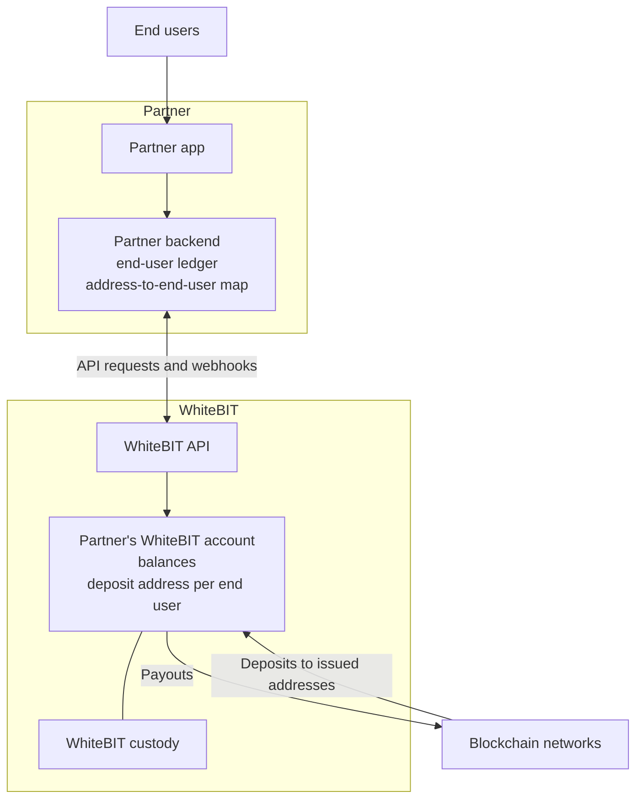

import EuOnboarding from '/snippets/eu-onboarding.mdx';

Crypto-as-a-Service (CaaS) lets a bank, fintech, or other business offer crypto to its end users under its
own brand. The partner runs the offering from its WhiteBIT account through the API: it issues a deposit
address per end user, keeps an end-user ledger, and pays out from the account. For how the integration is
assembled, see the [Integration guide](/guides/caas-integration).

<Tip>
CaaS orchestrates existing WhiteBIT building blocks rather than adding new API surface.
</Tip>

## What CaaS provides

- **A deposit address per end user** — issued from the partner's account for each currency and network. See
  [Address issuance and end-user mapping](/guides/caas-integration#address-issuance-and-end-user-mapping).
- **Conversion** — between supported assets at a quoted rate with [Convert](/platform/convert).
- **Crypto payouts** — withdrawals from the partner's account to the addresses end users choose. See
  [Payouts](/guides/caas-integration#payouts).
- **Fiat** — added in optional Phase 2 onboarding and run through the partner's WhiteBIT account. See the
  [On/Off-Ramp guide](/guides/on-off-ramp-integration).
- **Custody and security** — custody and the security certifications of the WhiteBIT platform. See
  [Security and compliance](#security-and-compliance).

## Who CaaS is for

| Segment | Typical use |
|---------|-------------|
| Banks | Offer digital assets to existing customers inside the bank's own product. |
| Fintechs | Let customers accept, store, and move digital assets across borders inside the partner app. |
| Telecom operators | Offer crypto buying and selling to subscribers. One implemented pattern is access through a USSD code (a carrier menu dialed as a short code). |
| Core banking providers | Integrate CaaS into the product suite and resell it as a white-label option to corporate customers. |

## How CaaS works

CaaS runs on the partner's own WhiteBIT account: the partner issues a deposit address per end user and keeps
the end-user ledger, and WhiteBIT processes deposits and payouts on the blockchain networks. See
[Integration models](/concepts/integration-models#partners-own-account) for how this compares with
sub-accounts and with customers' own accounts.

### Responsibilities

| Area | Partner | WhiteBIT |
|------|---------|----------|
| Verification | Verifies its own end users | Verifies the partner during institutional onboarding (KYB) |
| End-user records | Keeps the end-user ledger and the address-to-end-user map | Holds the account's balances and history |
| Deposits | Issues addresses, credits end users, reconciles against the history | Credits deposits to the account and sends deposit webhooks |
| Payouts | Approves each end-user payout and sends the withdrawal | Processes the withdrawal on the network |

<EuOnboarding />

## What end customers can do

- **Create crypto wallets** — a unique deposit address per end user. See the
  [Integration guide](/guides/caas-integration#address-issuance-and-end-user-mapping).
- **Store crypto in institutional custody** — see [Security and compliance](#security-and-compliance).
- **Buy and sell with fiat** — fiat access is added in optional Phase 2 onboarding and runs
  through the partner's WhiteBIT account; Convert accepts the supported fiat currencies as either
  leg of a conversion. See [Convert](/platform/convert) and the
  [On/Off-Ramp guide](/guides/on-off-ramp-integration).
- **Send and receive crypto** — on-chain transfers to and from external addresses.

## Program terms

Commercial terms are agreed per contract during onboarding.

## Onboarding and launch path

The path from first conversation to a live offering has four stages.

<Steps>
  <Step title="Approval">
    Review and agree the business case with the WhiteBIT team.
  </Step>
  <Step title="Onboarding">
    Complete institutional onboarding — KYC for the director or responsible person and KYB for the
    company (Phase 1, crypto operations), with an optional Phase 2 for fiat operations via SEPA. See
    [Institutional Onboarding](/institutional/onboarding).
  </Step>
  <Step title="Integration">
    Connect the partner platform to WhiteBIT through the API. See the
    [Integration guide](/guides/caas-integration).
  </Step>
  <Step title="Launch">
    Go live with the crypto functionality embedded in the partner product; timing depends on integration
    scope.
  </Step>
</Steps>

## Security and compliance

- **Certifications:** ISO 27001, CCSS Level 3, and PCI DSS Level 1; the CCSS Level 3 assessment
  is conducted by Hacken. See [Regulatory Compliance](/institutional/compliance).
- **Custody:** 96% of digital assets are stored in cold wallets ([CaaS product page](https://institutional.whitebit.com/crypto-as-a-service)).
- **Regional compliance (EEA):** MiCA restricts some stablecoin operations for EEA users, and the
  Travel Rule governs EEA and Turkey transfers. Both affect the assets and flows available to those
  end users. See [Regulatory Compliance](/institutional/compliance) and
  [Travel Rule](/concepts/travel-rule).
- **Data and licensing:** WhiteBIT processes data in the European Union and provides a Data
  Processing Agreement (DPA) on request. VASP registrations and DPA requests are handled by
  compliance@whitebit.com.

<Note>
End-user account mapping, the KYC/KYB split, and commercial terms are agreed and documented with
WhiteBIT during onboarding, before development starts. See
[Architecture alignment during onboarding](/guides/caas-integration#architecture-alignment-during-onboarding)
for the full list.
</Note>

## How to get started

1. Contact institutional@whitebit.com with the business case, target segment, and target regions.
2. Prepare for [Institutional Onboarding](/institutional/onboarding) — KYB, plus optional fiat
   access (Phase 2).
3. Build against the [Integration guide](/guides/caas-integration) and clear the
   [Go-Live Checklist](/best-practices/go-live-checklist) before real volume.

For compliance, VASP, and DPA matters, contact compliance@whitebit.com.

## What's next

<CardGroup cols={2}>
  <Card title="Integration guide" icon="cubes" href="/guides/caas-integration">
    Issue deposit addresses, credit deposits, pay out, and reconcile.
  </Card>
  <Card title="FAQ" icon="circle-question" href="/guides/caas-faq">
    Common questions on scope, deposit addresses, payouts, onboarding, and support.
  </Card>
  <Card title="Integration models" icon="sitemap" href="/concepts/integration-models">
    How the partner's own account compares with sub-accounts and customers' own accounts.
  </Card>
</CardGroup>
