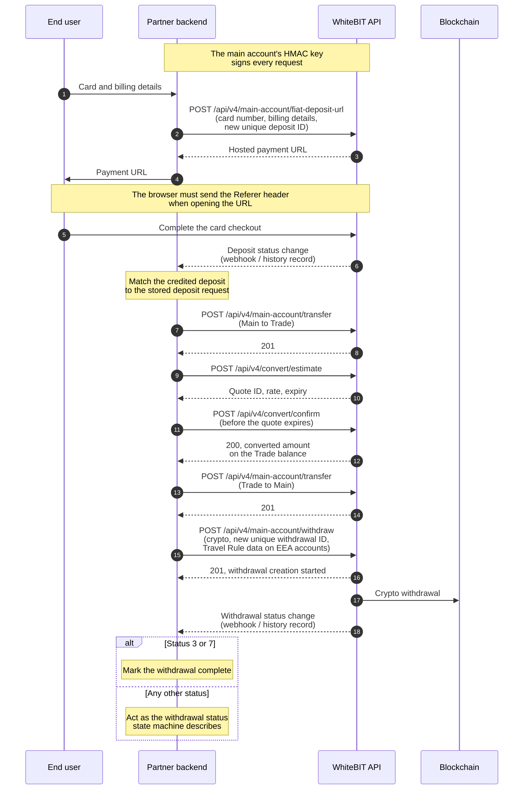
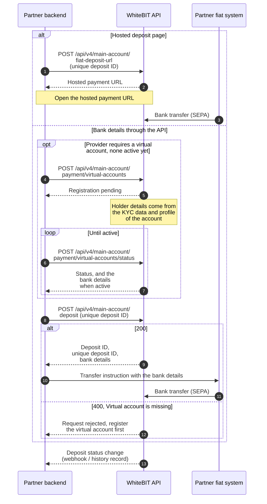
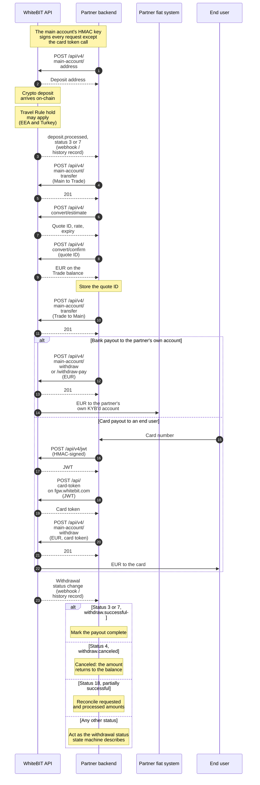

import { RegionBaseUrl } from '/snippets/RegionBaseUrl.jsx';

<RegionBaseUrl />

<Note>
  **For developers.** Fiat access is gated: it is the second phase of institutional onboarding and is not automatic after KYB. For positioning, the access gates, onboarding, and how to apply, see the [On/Off-Ramp overview](/guides/on-off-ramp-overview).
</Note>

All fiat operations run at the partner's main account, over v4 endpoints, in both directions: fiat in to crypto out, and crypto back to EUR. Each direction pairs a fiat leg with a conversion step and a crypto leg.

## Prerequisites

- **Completed institutional onboarding with approved fiat access** — a separate, non-automatic phase after KYB; see [How to get started](/guides/on-off-ramp-overview#how-to-get-started) on the overview page.
- **Per-account enablement gates** — the fiat deposit invoice endpoint, API deposits for each provider on the bank-details route, dedicated deposit addresses, and Express Withdraw are enabled per account. Confirm the invoice endpoint, the provider access, and Express Withdraw with the account manager; for dedicated deposit addresses, see [Unique address per user](/guides/payment-integration#unique-address-per-user). Express Withdraw is optional. It applies only when a WhiteBIT user pays a crypto amount from a WhiteBIT balance, and the amount settles off-chain in the partner's Main balance — see [Express Withdraw payments](/guides/payment-integration#express-withdraw-payments).
- **API access** — [HMAC-signed requests](/api-reference/authentication) on the main account.
- **Convert terms** — before the first conversion, the account owner accepts the Convert terms once on whitebit.com. See [Convert](/platform/convert).

<Warning>
  Since December 30, 2024, EEA accounts cannot deposit, withdraw, or create WhiteBIT Codes in USDT under MiCA. Use USDC or EURI for the crypto leg — see [Regulatory Compliance](/institutional/compliance).
</Warning>

## On-ramp flow: fiat in, crypto out

The sequence follows one card deposit through Convert to the crypto withdrawal.



For other outcomes, see [Results and retries](/platform/convert#results-and-retries), [Retry strategy by error type](/api-reference/rate-limits#retry-strategy-by-error-type), the [withdrawal status state machine](/guides/payment-integration#withdrawal-status-state-machine), and [Failure and exception paths](#failure-and-exception-paths).

<Note>
  The `fiat-deposit-url` endpoint works on demand. Request access through the account manager and provide the API key. Without activation, the endpoint returns a permission error.
</Note>

Generate a deposit invoice with a client-side `uniqueId` (any string up to 255 characters, new for each request; the endpoint rejects a value already taken). The `ticker` must be a [fiat](/glossary#fiat) currency with `can_deposit: true`, and the `provider` value comes from the Asset Status response — see the [provider](/glossary#provider) glossary entry:

<Tabs>
  <Tab title="curl">
    ```bash
    # Generate a fiat deposit invoice (provider value from Asset Status)
    curl -X POST "https://whitebit.com/api/v4/main-account/fiat-deposit-url" \
      -H "Content-Type: application/json" \
      -H "X-TXC-APIKEY: YOUR_API_KEY" \
      -H "X-TXC-PAYLOAD: YOUR_PAYLOAD" \
      -H "X-TXC-SIGNATURE: YOUR_SIGNATURE" \
      -d '{
        "ticker": "EUR",
        "provider": "PROVIDER",
        "amount": "100",
        "uniqueId": "deposit-2026-000123",
        "request": "/api/v4/main-account/fiat-deposit-url",
        "nonce": 1594297865000
      }'
    ```
  </Tab>
  <Tab title="Python">
    ```python
    import base64, hashlib, hmac, json, time, requests

    API_KEY, API_SECRET = "YOUR_API_KEY", "YOUR_SECRET"
    endpoint = "/api/v4/main-account/fiat-deposit-url"
    # provider value from the Asset Status response
    body = json.dumps({
        "ticker": "EUR",
        "provider": "PROVIDER",
        "amount": "100",
        "uniqueId": "deposit-2026-000123",
        "request": endpoint,
        "nonce": int(time.time() * 1000),
    })
    payload = base64.b64encode(body.encode()).decode()
    signature = hmac.new(API_SECRET.encode(), payload.encode(), hashlib.sha512).hexdigest()
    response = requests.post(
        "https://whitebit.com" + endpoint,
        headers={"Content-Type": "application/json", "X-TXC-APIKEY": API_KEY,
                 "X-TXC-PAYLOAD": payload, "X-TXC-SIGNATURE": signature},
        data=body,
    )
    print(response.json())  # {"url": "..."}
    ```
  </Tab>
</Tabs>

For Go and PHP examples, see [SDKs](/sdks). The signing process is documented in [Private HTTP API authentication](/api-reference/authentication).

Operational rules for the deposit leg:

- **SEPA payment reference.** WhiteBIT accepts bank transfers only from the partner's own KYB'd bank account. The `uniqueId` of the `fiat-deposit-url` request must appear in the SEPA payment-reference field of the transfer. A transfer without the reference, or with an altered one, may settle unmatched — see [SEPA payment reference](/guides/payment-integration#sepa-payment-reference).
- **Redirect links.** `successLink` and `failureLink` require feature activation through the account manager, and WhiteBIT validates the destination domain; `returnLink` needs no activation.
- **Card flows.** Card funding in USD or EUR (the VISAMASTER provider) requires a `customer` billing block, and the browser must send the `Referer` header when opening the invoice link — messengers and email clients often strip it. See [Card-provider flows](/guides/payment-integration#card-provider-flows).
- **Web-only currencies.** Not every fiat ticker is depositable via API; confirm `can_deposit` in the [Asset Status](/api-reference/market-data/asset-status-list) response before generating an invoice, and route unsupported tickers through the WhiteBIT web interface.

To complete the on-ramp, reach the currency for the crypto withdrawal through Convert where a conversion is needed. Convert through the API uses the Trade balance: transfer the source currency from Main to Trade, request a quote via `POST /api/v4/convert/estimate` after the transferred amount shows on the Trade balance, and execute it with `POST /api/v4/convert/confirm` before the quote expires. Then transfer the converted amount back to Main before the withdrawal (see [Convert balances](/platform/convert#balances)). The transfer request takes no idempotency key, and a transfer can still complete after a timeout or a `5xx`, so check [Get transfer history](/api-reference/account-wallet/get-transfer-history) before resending a transfer. The history lists a transfer only after the transfer completes, so repeat the check, and resend only when no matching record exists. Honor the per-quote expiry returned in the response rather than assuming a fixed window. Convert accepts the supported fiat currencies as either leg of a conversion. The crypto withdrawal step is documented in [Crypto Withdrawals](/guides/payment-integration#create-a-withdrawal); for EEA accounts the crypto withdrawal carries a Travel Rule payload — see [Travel Rule](/concepts/travel-rule) and the [EEA crypto withdrawal with Travel Rule use case](/guides/payment-integration#use-cases) (UC2).

### SEPA deposit from the partner's bank account

A SEPA deposit uses either the hosted deposit page or the bank details that [Create fiat deposit](/api-reference/account-wallet/create-fiat-deposit) returns, and the credited EUR then follows the conversion step above.



## Off-ramp flow: crypto in, fiat out

The sequence shows the partner's crypto arriving on the main account, the conversion to EUR, and the payout to the partner's own bank account or to an end user's card.



Statuses follow the [deposit lifecycle](/guides/payment-integration#deposit-lifecycle) and the [withdrawal status state machine](/guides/payment-integration#withdrawal-status-state-machine). For a conversion with an unknown result, follow [Results and retries](/platform/convert#results-and-retries).

Receive the crypto leg on a [deposit address](/api-reference/account-wallet/get-cryptocurrency-deposit-address) of the main account; dedicated per-transaction addresses via [`/create-new-address`](/api-reference/account-wallet/create-new-address-for-deposit) require per-account permission from the account manager. Inbound deposits for EEA and Turkey accounts are held until Travel Rule verification completes — see [Travel Rule](/concepts/travel-rule).

Convert the crypto to the fiat currency through the Trade balance: transfer the source currency from Main to Trade, convert it, and transfer the converted amount back to Main before the fiat withdrawal (see [Convert balances](/platform/convert#balances)).

For the fiat leg, choose the fee semantics: `POST /api/v4/main-account/withdraw` treats `amount` as including the fee, while `POST /api/v4/main-account/withdraw-pay` charges the fee on top so the recipient receives the specified amount. USD and EUR withdrawals require a `beneficiary` object; the required sub-fields vary by ticker and provider, so verify the current contract on the [Create Withdraw Request](/api-reference/account-wallet/create-withdraw-request) reference before integration. A `customerIp` field is additionally required for USD or EUR with the VISAMASTER provider.

For the VISAMASTER provider, pass the card token from [Issue card token](/api-reference/account-wallet/issue-card-token) in `address`; the withdraw endpoints do not accept a card number. Issue card token authenticates with a JWT, as its reference page describes.

The EUR SEPA IBAN example below uses the `SEPA_BCB_GROUP` provider, one of the SEPA/bank-rail providers (`SEPA`, `SEPA_CLEAR_JUNCTION`, `SEPA_BCB_GROUP`, `FINCI`, `ZEN`, `BANKING_CIRCLE`) that requires a top-level `bankBic` field carrying the beneficiary bank's BIC/SWIFT code; the active provider for the account is confirmed via the [Asset Status](/api-reference/market-data/asset-status-list) endpoint or the account manager.

The request body below sends an EUR IBAN transfer (SEPA), which goes only to the partner's own KYB'd bank account:

```json
{
  "ticker": "EUR",
  "amount": "500",
  "address": "DE89370400440532013000",
  "bankBic": "DEUTDEFF",
  "beneficiary": {
    "firstName": "Firstname",
    "lastName": "Lastname"
  },
  "provider": "SEPA_BCB_GROUP",
  "uniqueId": "24529046",
  "request": "/api/v4/main-account/withdraw",
  "nonce": 1594297865000
}
```

- **Partial withdrawals.** `partialEnable: true` raises the maximum limit for fiat withdrawals; the application must then handle the `Partially successful` status (18) and reconcile `requestAmount` against `processedAmount` in the history record.
- **KYC.** Fiat withdrawals require KYC verification. In exceptional, documented cases the institutional team can arrange a per-account override — see [Fiat withdrawal](/guides/payment-integration#fiat-withdrawal).

<Warning>
  Withdrawals are irreversible once processed. Validate the destination details and amounts before submitting, and test the flow with minimum amounts first — no public testnet or sandbox is available.
</Warning>

## Reconciliation and monitoring

Webhooks are optional and add speed; run scheduled history polling either way. To use webhooks, verify the domain, then configure the webhook URL — see [Webhooks](/platform/webhook) for the setup flow. Verify the HMAC-SHA512 signature on every delivery using the `X-TXC-APIKEY`, `X-TXC-PAYLOAD`, and `X-TXC-SIGNATURE` headers, and track the strictly increasing `nonce` in each payload. WhiteBIT retries delivery a small number of times spaced roughly an hour apart over a window of about one day; treat the cadence as best-effort. There is no webhook replay mechanism, so pair webhooks with polling: query `POST /api/v4/main-account/history` (`transactionMethod: 1` for deposits, `2` for withdrawals) on a regular cycle and deduplicate against received events. The [reconciliation pattern](/guides/payment-integration#webhook-reconciliation) in the Payment Integration guide walks through the full loop.

The identifier appears under different names across the API surface:

| Field | Where it appears | Meaning |
|-------|-----------------|---------|
| `uniqueId` | `fiat-deposit-url` and withdrawal requests | Client-side transaction identifier, up to 255 characters, unique for each deposit or withdrawal |
| `unique_id` | History filter and records | The deposit/withdraw identifier in history responses |
| `transactionId` | `refund-deposit` request, refund webhooks | Deposit transaction UUID, sourced from the `deposit.canceled` webhook or the deposit history |
| `id` | `refund-deposit` response | The same deposit transaction UUID, echoed back — not a refund identifier |
| `depositId` | `refund-history` filter and records | The same deposit transaction UUID |
| `refundId` | `refund-history` records | The refund's own UUID, returned only by refund history |
| `transaction_id` | History records | System-wide transaction UUID, never reused |

No field ties a conversion to the withdrawal that spends it; see [Convert in payment flows](/platform/convert#convert-in-payment-flows) for the reconciliation method.

Mark transactions complete only at terminal statuses: 3/7 for success, 4/9 for canceled deposits, 4 for canceled withdrawals. A canceled withdrawal (status 4) returns the amount to the balance. Handle every status in the [deposit status table](/guides/payment-integration#deposit-status-state-machine) and the [withdrawal status table](/guides/payment-integration#withdrawal-status-state-machine), and poll deposits without a `status` filter. WhiteBIT publishes platform availability at [status.whitebit.com](https://status.whitebit.com); per-asset deposit and withdrawal availability is reported by the [Asset Status](/api-reference/market-data/asset-status-list) endpoint.

## Failure and exception paths

Build handling for each of these before go-live:

| Scenario | Documented behavior | Partner action |
|----------|--------------------|----------------|
| SEPA deposit against a `fiat-deposit-url` invoice arrives without the `uniqueId` payment reference | The transfer may settle unmatched | Add the reference to every transfer made against a `fiat-deposit-url` invoice |
| Deposit canceled (status 4) | The `deposit.canceled` webhook fires; canceled crypto deposits may be refundable | Trigger [`refund-deposit`](/api-reference/account-wallet/refund-deposit) with the transaction UUID and an external refund address. Track the result in [Get refund history](/api-reference/account-wallet/get-refund-history) filtered by `depositId`: `successful` and `canceled` are final; `in_process` is not final, even after a `refund.failed` webhook. See [Refund flow](/guides/payment-integration#refund-flow) |
| Deposit canceled (status 9) | No webhook is sent; the record appears only in the deposit history. A deposit in status 9 that was never frozen cannot be refunded through the API | Detect the status by polling the history. Close the transaction when the deposit was never frozen |
| Deposit unconfirmed by the user (status 5) | The transaction waits for manual confirmation on the platform | Notify the account holder to complete the manual confirmation at whitebit.com; track the status via history polling |
| Deposit on hold (status 21) | The record surfaces in the deposit history with status 21 | Wait for the compliance review; escalate to institutional@whitebit.com if the freeze lasts more than 24 hours |
| Deposit held for Travel Rule (status 27/28) | No webhook fires for Travel Rule transitions; the hold surfaces via history polling. A deposit rejected under the Travel Rule is canceled and eligible for refund | Status 27: submit originator data via the [deposit verification endpoint](/api-reference/travel-rule/submit-deposit-verification) where the Travel Rule API is enabled; otherwise notify the account holder to complete verification at whitebit.com. Status 28: wait while the data is under review. After a rejection, return the funds through the [refund flow](/guides/payment-integration#refund-flow) |
| Partial fiat withdrawal (status 18, with `partialEnable`) | Part of the withdrawal succeeds | Reconcile `requestAmount` against `processedAmount` and surface the remainder to operations |
| Conversion returns `400` code `0` or a `5xx` | The conversion may have executed | Follow [Results and retries](/platform/convert#results-and-retries) before converting again |
| Quote expires before the confirm request, or the platform refuses the confirm request after a price move (rare) | Nothing converts | Request a new estimate — see [Conversion flow](/platform/convert#conversion-flow) and [Results and retries](/platform/convert#results-and-retries) |
| Fiat withdrawal without KYC | The request fails validation with an account-verification error | Complete KYC, or arrange the exception-only override with the institutional team |
| VISAMASTER invoice link opened without a `Referer` header | The end user lands on the WhiteBIT homepage instead of the payment provider | Test the redirect in the real delivery surface — messengers and email clients strip the header |

## What's next

<CardGroup cols={3}>
  <Card title="On/Off-Ramp FAQ" icon="circle-question" href="/guides/on-off-ramp-faq">
    Activation, SEPA matching, fee semantics, reconciliation, and compliance questions.
  </Card>
  <Card title="Payment Integration" icon="arrow-right-arrow-left" href="/guides/payment-integration">
    Endpoint-level lifecycle reference: statuses, fees, fiat operations, refunds.
  </Card>
  <Card title="Go-Live Checklist" icon="clipboard-check" href="/best-practices/go-live-checklist">
    Pre-production readiness verification for keys, webhooks, and compliance.
  </Card>
</CardGroup>
