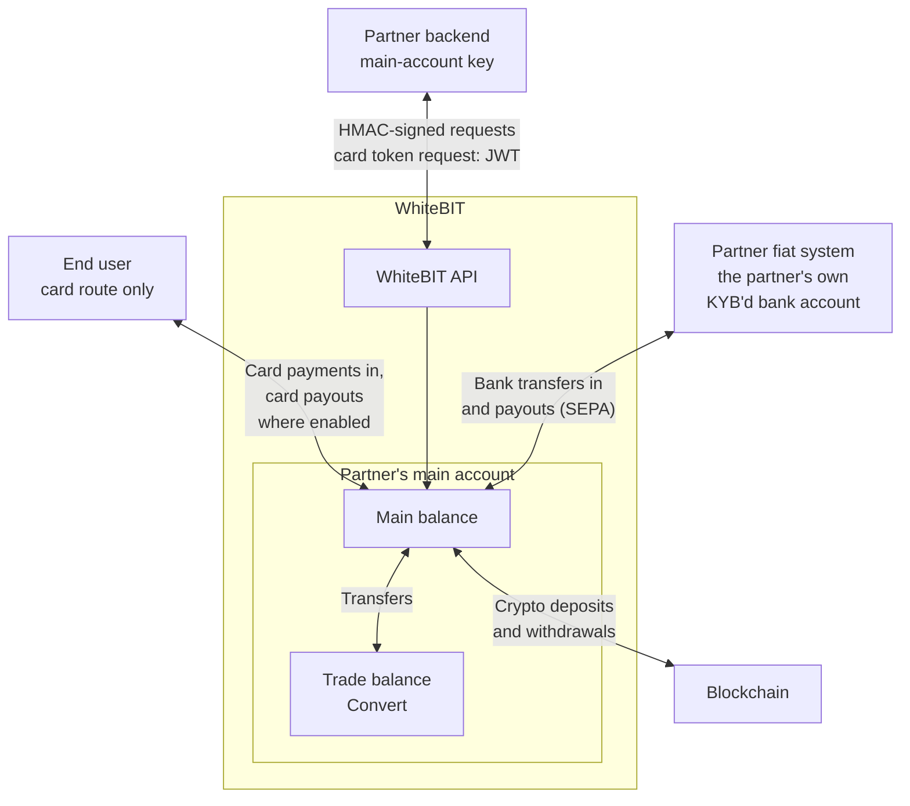

import { RegionBaseUrl } from '/snippets/RegionBaseUrl.jsx';

<RegionBaseUrl />

The WhiteBIT on/off-ramp integration moves corporate funds between fiat and digital assets, in both directions — fiat in to crypto out, and crypto back to EUR — with all fiat operations at the partner's main account. For the flows, code, and reconciliation, see the [Integration guide](/guides/on-off-ramp-integration).

<Tip>
  The [On/Off-Ramp FAQ](/guides/on-off-ramp-faq) answers the common questions on activation, SEPA matching, fee semantics, reconciliation, and compliance.
</Tip>

Adjacent scenarios route to separate guides:

- The integration collects payments from end users or processes merchant flows — see [Payment Integration](/guides/payment-integration).
- End customers hold dedicated accounts under a partner main account — see the [Embedded Trading integration guide](/guides/sub-account-integration).
- For the full partner-type map, see [Partner Solutions](/guides/partner-solutions).

## What On/Off-Ramp provides

- **Fiat deposits via API** — a hosted payment URL for card checkout or for a SEPA bank transfer, per the providers enabled for the account. A bank transfer comes only from the partner's own KYB'd bank account and can also use the bank details that [Create fiat deposit](/api-reference/account-wallet/create-fiat-deposit) returns.
- **Fiat withdrawals via API** — EUR payouts over IBAN (SEPA) to the partner's own KYB'd bank account, plus card rails where enabled, each carrying a beneficiary record.
- **Quoted-rate conversion** — Convert on the Trade balance: a confirmed quote executes in full at the quoted amounts or not at all, so the rate is known up front.
- **The crypto leg** — deposit addresses, withdrawals, and the refund flow.
- **Reconciliation** — signed webhooks plus history polling with client-side identifiers.

The [Integration guide](/guides/on-off-ramp-integration) documents each endpoint, the request bodies, and both directions.

## Who On/Off-Ramp is for

- **Corporate crypto investors** — convert company treasury funds between EUR and digital assets on the main account.
- **Businesses settling revenue over EUR rails** — move payouts or revenue between fiat and crypto without operating end-user accounts.
- **Crypto-native companies with fiat obligations** — off-ramp digital assets to EUR to pay suppliers, payroll, or tax from the company bank account.
- **Fiat-first companies funding on-chain operations** — on-ramp EUR to USDC or other digital assets for on-chain payouts, vendor settlement, or protocol operations on the main account.

## How it works

Requests authenticate with an [HMAC-signed API key](/api-reference/authentication) on the partner's main account. The one exception is the card payout step: [Issue card token](/api-reference/account-wallet/issue-card-token) takes a JWT from the HMAC-signed [Issue JWT token](/api-reference/account-wallet/issue-jwt-token) endpoint. Crypto operations are available after standard account setup; fiat operations require completed [Institutional Onboarding](/institutional/onboarding) with approved fiat access — a separate, non-automatic phase after KYB. The [Integration guide](/guides/on-off-ramp-integration) covers both directions end to end: the fiat leg, the conversion step, and the crypto leg.

The diagram shows where funds move between the partner, an end user's card, the partner's main account, and the blockchain.

## Program terms

Fee and limit figures are set per individual agreement, so no numbers appear in these pages. During onboarding, the account manager confirms:

- The fee schedule for fiat deposits and withdrawals applicable to the account.
- Deposit and withdrawal limits, for both fiat and crypto.
- The enabled currency and provider matrix. At runtime, [Asset Status](/api-reference/market-data/asset-status-list) reports the per-currency `can_deposit` / `can_withdraw` flags and the request `provider` values; the [Fee](/api-reference/market-data/fee) endpoint reports the public fee schedule and limits per fiat asset, the same for every caller.
- Settlement windows and cutoff behavior for the fiat rails in use, including weekends and holidays.

The account's deposit and withdrawal limit is a rolling monthly limit counted in USD equivalent. For bank transfers, WhiteBIT sets the account's limit from the source-of-funds and source-of-wealth information provided during onboarding; the account manager confirms the values.

## Compliance essentials

Compliance shapes which assets and flows are available to the account. The [Integration guide](/guides/on-off-ramp-integration) shows how each constraint affects requests; [Regulatory Compliance](/institutional/compliance) holds the full reference.

- **MiCA (EEA):** EEA accounts cannot deposit, withdraw, or create WhiteBIT Codes in USDT since December 30, 2024. Use USDC or EURI for the crypto leg. See [Regulatory Compliance](/institutional/compliance).
- **Travel Rule (EEA and Turkey):** inbound crypto deposits are held until Travel Rule verification completes; crypto withdrawals from EEA accounts carry a Travel Rule payload. See [Travel Rule](/concepts/travel-rule).
- **Fiat KYC:** fiat withdrawals require KYC verification. In exceptional, documented cases the institutional team can arrange a per-account override.

## How to get started

Fiat access is the second phase of [Institutional Onboarding](/institutional/onboarding) and is not automatic after KYB approval. Phase 1 (corporate account, KYB, API keys) enables crypto operations; Phase 2 adds EUR/SEPA capabilities after review by a fiat processing partner, with source-of-funds documentation. WhiteBIT manages the fiat-partner onboarding on the applicant's behalf.

**How to apply:** email **institutional@whitebit.com** with a description of the service. Include the registered legal entity (name, registration number, jurisdiction), licenses or registrations held, whether the scope is crypto-only or fiat as well, and the countries where the service operates. The full application question list is on the [Partner Solutions](/guides/partner-solutions#how-to-apply) page.

<Note>
  Fiat deposits and withdrawals operate at the partner's **main account** (institutional fiat access). End users pay by card through the hosted payment URL, and WhiteBIT credits the euros to the partner's main account.
</Note>

Six capabilities in the ramp integration carry a dedicated enablement gate:

| Capability | Gate | Contact |
|-----------|------|---------|
| Fiat operations (Phase 2) | Institutional onboarding, fiat-partner review | institutional@whitebit.com |
| `fiat-deposit-url` endpoint | Per-account activation | Account manager, with the API key |
| Bank-details deposits (`/main-account/deposit`) | Per-provider API deposit access; the endpoint enabled in the API key settings | Account manager |
| `successLink` / `failureLink` redirects | Feature activation, domain validated | Account manager |
| Dedicated deposit addresses (`/create-new-address`) | Per-account permission | Account manager |
| Travel Rule API | Per-account enablement | Account manager |

## Support and contacts

- **Onboarding status, limits, and institutional matters:** institutional@whitebit.com, or the assigned account manager once onboarded.
- **Fiat endpoint enablement and access questions:** the account manager, with the API key included in the request.
- **Dedicated deposit addresses:** the account manager.
- **OTC block trading** for large conversions is part of the institutional catalog — see the [Institutional Overview](/institutional/overview).
- **Self-service:** [help.whitebit.com](https://help.whitebit.com) for platform questions; this portal for API documentation.

## What's next

<CardGroup cols={3}>
  <Card title="Integration" icon="code" href="/guides/on-off-ramp-integration">
    The on-ramp and off-ramp flows, code, reconciliation, and failure paths.
  </Card>
  <Card title="On/Off-Ramp FAQ" icon="circle-question" href="/guides/on-off-ramp-faq">
    Activation, SEPA matching, fee semantics, reconciliation, and compliance questions.
  </Card>
  <Card title="Institutional Onboarding" icon="building" href="/institutional/onboarding">
    The two-phase KYB and fiat access process with the document checklist.
  </Card>
</CardGroup>
