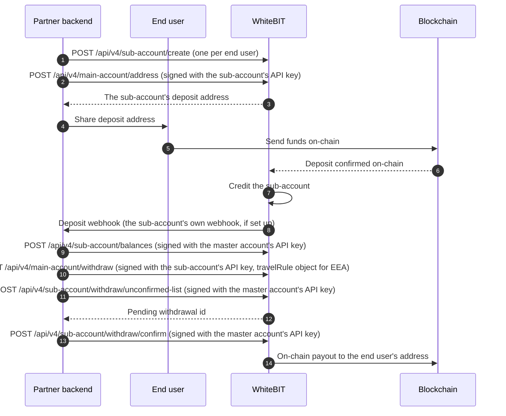

import PartnerEligibility from '/snippets/partner-eligibility.mdx';
import FeeShare from '/snippets/fee-share.mdx';

<Note>
**For developers.** This page covers the technical integration. For what WaaS is, the verification variants at a
business level, and how to apply, see the [WaaS overview](/guides/waas-overview).
</Note>

WaaS runs on Model A, a partner-operated sub-account per end user (see
[Integration models](/concepts/integration-models)). Account creation, per-sub-account API keys, and KYC
URLs are documented in [Account architecture](/guides/sub-account-integration#account-architecture) and
[Customer onboarding flow](/guides/sub-account-integration#customer-onboarding-flow); this guide covers
the wallet flows on top.

## Prerequisites

- **Approved WaaS partner enrollment** — see the [WaaS overview](/guides/waas-overview) for what WaaS provides and how to apply.
- **A chosen verification variant** — managed sub-accounts, KYC reliance, or shared-KYC sub-accounts; see [Build path per variant](#build-path-per-variant).
- **API access** — [HMAC-signed requests](/api-reference/authentication); a `type: 2` API key (deposits and withdrawals) on each sub-account; sub-accounts, crypto deposits to sub-accounts, and the sub-account withdrawal endpoints enabled for the account by the account manager.

## Build path per variant

- **Managed sub-accounts.** The partner creates a sub-account per end user under the master account (`POST /api/v4/sub-account/create` with `shareKyc: false`), and WhiteBIT verifies each end user through a KYC URL. Build with [Sub-Accounts](/products/sub-accounts/overview) for account creation and management, and the [customer onboarding flow](/guides/sub-account-integration#customer-onboarding-flow) for the KYC URL and per-customer API keys.
- **Sub-accounts with KYC reliance.** The same sub-account architecture as the managed variant, but the partner performs end-user KYC instead of WhiteBIT, under a Compliance-approved agreement. Build with the same [Embedded Trading integration guide](/guides/sub-account-integration); complete [Institutional Onboarding](/institutional/onboarding) first to establish the reliance agreement. See [KYC reliance eligibility](#kyc-reliance-eligibility) below for the conditions.
- **Shared-KYC sub-accounts.** The partner creates a sub-account per end user with `shareKyc: true`, and each sub-account carries the master account's verification. WhiteBIT verifies the partner during [Institutional Onboarding](/institutional/onboarding) (KYB); the partner verifies its own end users. No KYC URL or email confirmation applies, and the sub-account accepts permissions at creation. Build with [Sub-Accounts](/products/sub-accounts/overview) and the [Embedded Trading integration guide](/guides/sub-account-integration), skipping its end-customer KYC steps.

Commercial terms for the program:

<FeeShare />

## KYC reliance eligibility

<PartnerEligibility />

## Payment and payout flows

Fund-movement mechanics, with parameters and code examples, are in the
[Sub-Accounts quickstart](/products/sub-accounts/quickstart) and the
[Payment Integration guide](/guides/payment-integration). The deposit and payout cycle for one end user's
sub-account:

A sub-account counts as a separate account and can have its own webhook. Webhook delivery is retried but
has no replay, so poll the deposit history of each sub-account on a schedule as well, even when a webhook is configured.
Use `POST /api/v4/main-account/history` with `transactionMethod: 1`, signed with the sub-account's API key. Deduplicate by `uniqueId`. Act on each deposit status as the [Deposit status state machine](/guides/payment-integration#deposit-status-state-machine) describes. Not every deposit ends credited: some end canceled, and some wait in a frozen or uncredited status. See [Webhooks](/platform/webhook) for signatures and delivery semantics. API
[rate limits](/api-reference/rate-limits) apply per endpoint; sub-account limits are set per agreement.

<Note>
  Fiat deposit and withdrawal operate at the **master-account** level (institutional fiat access).
  Per-end-user fiat rails are not a standard shipped capability; confirm any such requirement with
  WhiteBIT first.
</Note>

<Warning>
**Compliance requirements that affect the requests:**
- EEA withdrawals require a `travelRule` object; in the sub-account models the partner submits it
  for each sub-account withdrawal it initiates. Inbound EEA/Turkey deposits are held until
  verification completes. See [Travel Rule](/concepts/travel-rule).
- For EEA users, use USDC or EURI, not USDT. See [Regulatory Compliance](/institutional/compliance).
</Warning>

## More flows

Additional use cases (conversion payouts, refunds, exact-amount payouts, multichain payouts) are
catalogued in [Recipes](/guides/waas-recipes), with the full parameter reference in the
[Payment Integration guide](/guides/payment-integration).

**Travel Rule (programmatic):** submit originator data via `travel-rule/deposit/verification` and
fetch the VASP list via `travel-rule/vasps` (EEA and Turkey). See [Travel Rule](/concepts/travel-rule).

## Testing

WhiteBIT does not offer a public testnet or sandbox. Test on the live API with minimum amounts,
and check per-asset minimums via the [Asset Status](/api-reference/market-data/asset-status-list)
endpoint first. The WhiteBIT Codes flow is a low-risk way to try a real signed call on a small
amount (see [Recipes](/guides/waas-recipes)).

## What's next

<CardGroup cols={2}>
  <Card title="WaaS Recipes" icon="sparkles" href="/guides/waas-recipes">
    Runnable examples and the starter repo.
  </Card>
  <Card title="Payment Integration" icon="arrow-right-arrow-left" href="/guides/payment-integration">
    Endpoint-level reference for every payment and payout flow.
  </Card>
  <Card title="FAQ" icon="circle-question" href="/guides/waas-faq">
    Scope, verification variants, onboarding, and compliance questions.
  </Card>
</CardGroup>
