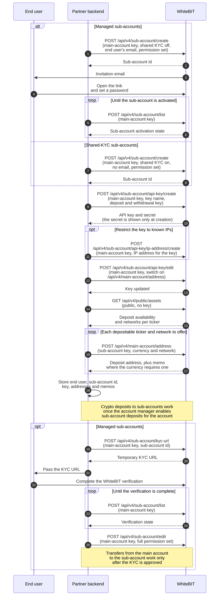
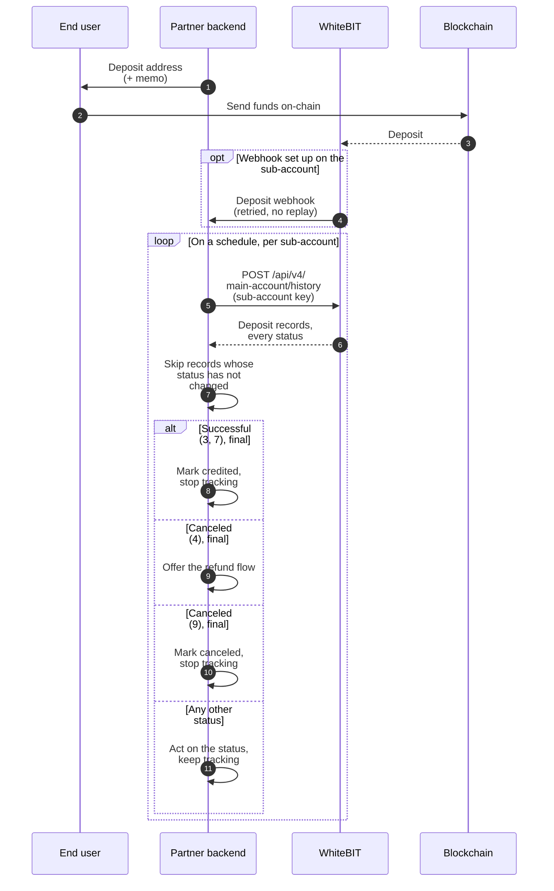
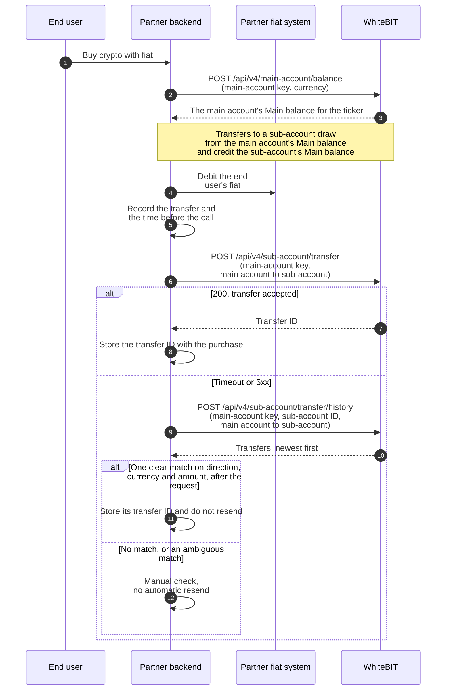
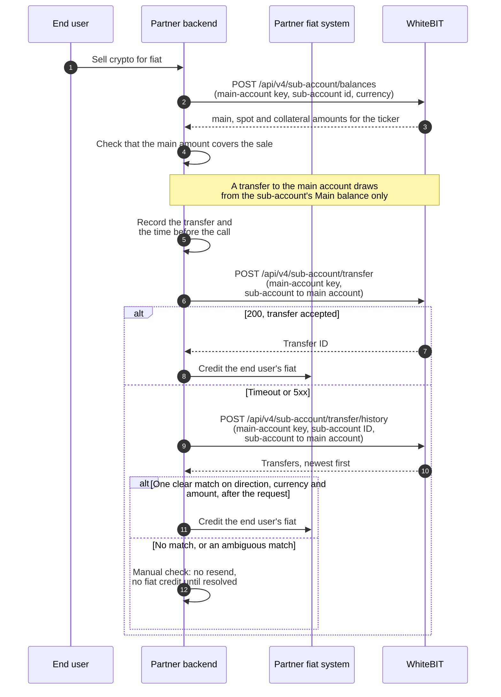
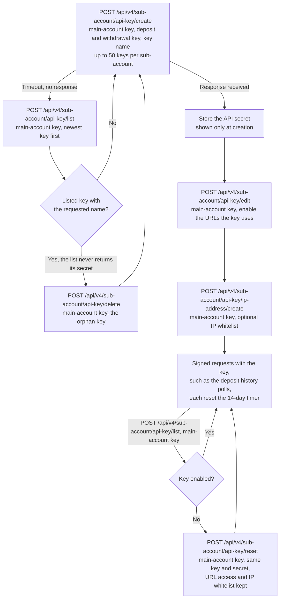

import PartnerEligibility from '/snippets/partner-eligibility.mdx';
import FeeShare from '/snippets/fee-share.mdx';
import SubAccountLimit from '/snippets/text/sub-account-limit.mdx';
import KeyCreateNoResponse from '/snippets/text/key-create-no-response.mdx';
import TransferNoIdempotency from '/snippets/text/transfer-no-idempotency.mdx';
import SubAccountWithdrawal from '/snippets/diagrams/sub-account-withdrawal.mdx';
import SubAccountOffboarding from '/snippets/diagrams/sub-account-offboarding.mdx';

<Note>
**For developers.** This page covers the technical integration. For what WaaS is, the verification variants at a
business level, and how to apply, see the [WaaS overview](/guides/waas-overview).
</Note>

WaaS runs on Model A, a partner-operated sub-account per end user (see
[Integration models](/concepts/integration-models)). Account creation, per-sub-account API keys, and KYC
URLs are documented in [Account architecture](/guides/sub-account-integration#account-architecture) and
[Customer onboarding flow](/guides/sub-account-integration#customer-onboarding-flow); this guide covers
the wallet flows on top.

## Prerequisites

- **Approved WaaS partner enrollment** — see the [WaaS overview](/guides/waas-overview) for what WaaS provides and how to apply.
- **A chosen verification variant** — managed sub-accounts, KYC reliance, or shared-KYC sub-accounts; see [Build path per variant](#build-path-per-variant).
- **API access** — [HMAC-signed requests](/api-reference/authentication); a `type: 2` API key (deposits and withdrawals) on each sub-account, with the URLs the integration calls enabled (every URL group starts switched off on a new key); crypto deposits to sub-accounts and the sub-account withdrawal endpoints enabled for the account by the account manager.
- **Sub-account limit** — a main account holds up to 50 sub-accounts by default; the assigned account manager raises the limit on request.

## Build path per variant

- **Managed sub-accounts.** The partner creates a sub-account per end user under the main account (`POST /api/v4/sub-account/create` with `shareKyc: false` and the end user's `email`). WhiteBIT emails the end user an invitation, and the sub-account is activated once the end user opens the link and sets a password. WhiteBIT then verifies each end user through a KYC URL; transfers from the main account to the sub-account are refused until the KYC is approved. Build with [Sub-Accounts](/products/sub-accounts/overview) for account creation and management, and the [customer onboarding flow](/guides/sub-account-integration#customer-onboarding-flow) for the KYC URL and per-customer API keys.
- **Sub-accounts with KYC reliance.** The same sub-account architecture as the managed variant, but the partner performs end-user KYC instead of WhiteBIT, under a Compliance-approved agreement. The partner creates each sub-account with `shareKyc: true` and no `email`, so the sub-account is active at creation with no invitation step; a request with `email` starts the invitation flow instead. Build with the same [Embedded Trading integration guide](/guides/sub-account-integration); complete [Institutional Onboarding](/institutional/onboarding) first to establish the reliance agreement. See [KYC reliance eligibility](#kyc-reliance-eligibility) below for the conditions.
- **Shared-KYC sub-accounts.** The partner creates a sub-account per end user with `shareKyc: true`, and each sub-account carries the main account's verification. WhiteBIT verifies the partner during [Institutional Onboarding](/institutional/onboarding) (KYB); the partner verifies its own end users. Leave `email` out of the create request: a request with `email` starts the invitation flow even with `shareKyc: true`. No invitation, activation or KYC URL step applies: the sub-account is active at creation, and `spotEnabled` and `collateralEnabled` apply at once. Build with [Sub-Accounts](/products/sub-accounts/overview) and the [Embedded Trading integration guide](/guides/sub-account-integration), skipping its end-customer KYC steps.

Commercial terms for the program:

<FeeShare />

## KYC reliance eligibility

<PartnerEligibility />

## Payment and payout flows

Fund-movement mechanics, with parameters and code examples, are in the
[Sub-Accounts quickstart](/products/sub-accounts/quickstart) and the
[Payment Integration guide](/guides/payment-integration). Each diagram below covers one end user's sub-account and
names the key that signs each request: the main-account key or the sub-account's own key.

<Note>
  Fiat deposits and withdrawals operate on the **main account** (institutional fiat access), from and to
  the partner's own bank account only. End users' fiat stays in the partner's own system.
</Note>

<Warning>
**Compliance requirements that affect the requests:**
- EEA withdrawals require a `travelRule` object; in the sub-account models the partner submits it
  for each sub-account withdrawal it initiates. Inbound EEA/Turkey deposits are held until
  verification completes. See [Travel Rule](/concepts/travel-rule).
- For EEA users, use USDC or EURI, not USDT. See [Regulatory Compliance](/institutional/compliance).
</Warning>

### Wallet creation

Wallet creation runs once per end user: the sub-account, its `type: 2` API key with the deposit-address URL enabled, and a deposit address per ticker and
network. Managed sub-accounts add the activation and KYC URL steps from the
[customer onboarding flow](/guides/sub-account-integration#customer-onboarding-flow): the API key and deposit addresses
can be created once the end user activates the sub-account, and only transfers from the main account wait for the KYC
approval. Shared-KYC sub-accounts skip both steps.
WhiteBIT and the partner agree the KYC reliance setup during onboarding; see
[Build path per variant](#build-path-per-variant).

### Deposits

The diagram follows one deposit from the address shown to the end user to a final status.

A sub-account counts as a separate account and can have its own webhook, created at whitebit.com only: the main account switches the session to the sub-account and creates the webhook there. The main account's webhook does not receive sub-account events, and payloads carry no sub-account identifier. Webhook delivery is retried but
has no replay, so poll the deposit history of each sub-account on a schedule as well, even when a webhook is configured.
Use `POST /api/v4/main-account/history` with `transactionMethod: 1`, signed with the sub-account's API key. Deduplicate by `uniqueId`. Act on each deposit status as the [Deposit status state machine](/guides/payment-integration#deposit-status-state-machine) describes. Not every deposit ends credited: some end canceled, and some stay in status 21 (on hold) or 22 (uncredited) before reaching a final status. See [Webhooks](/platform/webhook) for signatures and delivery semantics. API
[rate limits](/api-reference/rate-limits) apply per endpoint.

The `main` amount from `POST /api/v4/sub-account/balances` includes deposits credited before the network fully confirms
the deposits. The sub-account's key reads the part still held back as `pending_deposit_amount` from
`POST /api/v4/main-account/balance`, once `/api/v4/main-account/balance` is switched on for the key with
`POST /api/v4/sub-account/api-key/edit`. The held part cannot be withdrawn to a blockchain address or moved to the
Collateral balance until the network confirms the deposit.

<SubAccountLimit />

### Crypto purchases with fiat

In a purchase, the partner debits the end user's fiat in the partner's own system and transfers the crypto from the
main account to the sub-account. For a managed sub-account, WhiteBIT refuses the transfer until the end user's KYC is
approved, and the refusal names the `to` field; offer purchases only after the approval.

<TransferNoIdempotency />

See [Retry strategy by error type](/api-reference/rate-limits#retry-strategy-by-error-type) for the retry rule of each
error type.

### Crypto sales for fiat

In a sale, the partner transfers the crypto from the sub-account's Main balance to the main account and credits the
end user's fiat once WhiteBIT accepts the transfer with a `200` response; the balances change a moment later. After a
timeout or a `5xx`, the partner checks the transfer history: one clear match counts as the transfer, and no match or an
ambiguous match is a manual check, not an automatic resend.

### Withdrawals

The sub-account's `type: 2` key creates each withdrawal, and the main-account key confirms it before processing
starts. The account manager enables the sub-account withdrawal endpoints.
[Sub-account withdrawal approval](/products/sub-accounts/quickstart#sub-account-withdrawal-approval) gives the request for each approval step.
A waiting withdrawal does not expire and sends no webhook: find it in the [unconfirmed-withdrawals list](/api-reference/sub-accounts/list-unconfirmed-sub-account-withdrawals) with the main-account key.

<SubAccountWithdrawal />

Act on each withdrawal status as the [Withdrawal status state machine](/guides/payment-integration#withdrawal-status-state-machine) describes.

### Conversion

Conversion on a sub-account uses the requests in [Convert balances](/platform/convert#balances) and
[Conversion in the withdrawal flow](/guides/payment-integration#conversion-in-the-withdrawal-flow), signed with the
sub-account's key, on the sub-account's Trade balance. The partner transfers the source currency from the Main balance to
the Trade balance and requests the estimate after the transferred amount shows on the Trade balance. Before a
withdrawal or a sale, the partner transfers the converted amount back to the Main balance, because the withdrawal endpoints
and a transfer to the main account both draw from the sub-account's Main balance only. The transfer to Trade needs the
sub-account's spot permission (`spotEnabled`). The main account's one-time acceptance of the Convert terms on whitebit.com
covers its sub-accounts; sub-accounts do not accept the terms separately.

Every URL group starts switched off on a new sub-account key, so before the first conversion the partner enables
`/api/v4/convert/estimate`, `/api/v4/convert/confirm`, and the balance transfer `/api/v4/main-account/transfer` on the
sub-account's key with [Edit Sub-Account API Key](/api-reference/sub-accounts/edit-sub-account-api-key), signed with the main-account key.

## API key lifecycle

The [14-day deactivation of unused keys](/best-practices/security#key-rotation) applies to sub-account keys too, and any
authenticated request, such as a deposit history poll, resets the timer.

<KeyCreateNoResponse />

## End-user offboarding

Offboarding empties the sub-account through a final withdrawal or a sale, then the main-account key blocks it. The
sub-account's key creates the final withdrawal and the main account confirms it, as in [Withdrawals](#withdrawals).
A sale follows [Crypto sales for fiat](#crypto-sales-for-fiat). The partner keeps the end user's mapping to the
sub-account and its addresses.

<SubAccountOffboarding />

## More flows

Additional use cases (conversion payouts, refunds, exact-amount payouts, multichain payouts) are
catalogued in [Recipes](/guides/waas-recipes), with the full parameter reference in the
[Payment Integration guide](/guides/payment-integration).

**Travel Rule (programmatic):** submit originator data via `travel-rule/deposit/verification` and
fetch the VASP list via `travel-rule/vasps` (EEA and Turkey). See [Travel Rule](/concepts/travel-rule).

## Testing

WhiteBIT does not offer a public testnet or sandbox. Test on the live API with minimum amounts,
and check per-asset minimums via the [Asset Status](/api-reference/market-data/asset-status-list)
endpoint first. Where the response includes `limits`, a crypto deposit is checked against the network minimum (`limits.deposit.<network>.min`). A test deposit below the network
minimum is not credited at once: it waits in status 22, and unless the deposits to the same address add up to the minimum, it is canceled with status 9 after 7 days. The WhiteBIT Codes flow is a low-risk way to try a real signed call on a small
amount (see [Recipes](/guides/waas-recipes)).

## What's next

<CardGroup cols={2}>
  <Card title="WaaS Recipes" icon="sparkles" href="/guides/waas-recipes">
    Runnable examples and the starter repo.
  </Card>
  <Card title="Payment Integration" icon="arrow-right-arrow-left" href="/guides/payment-integration">
    Endpoint-level reference for every payment and payout flow.
  </Card>
  <Card title="FAQ" icon="circle-question" href="/guides/waas-faq">
    Scope, verification variants, onboarding, and compliance questions.
  </Card>
</CardGroup>
