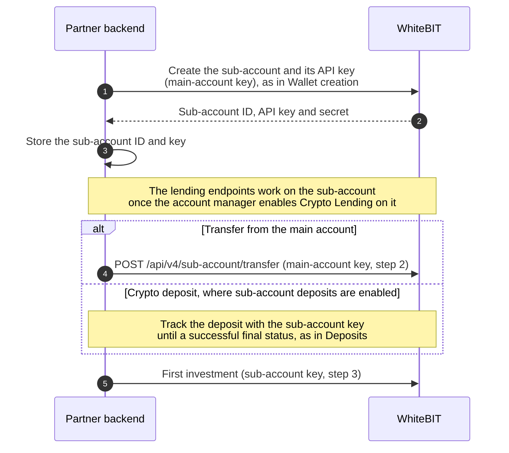
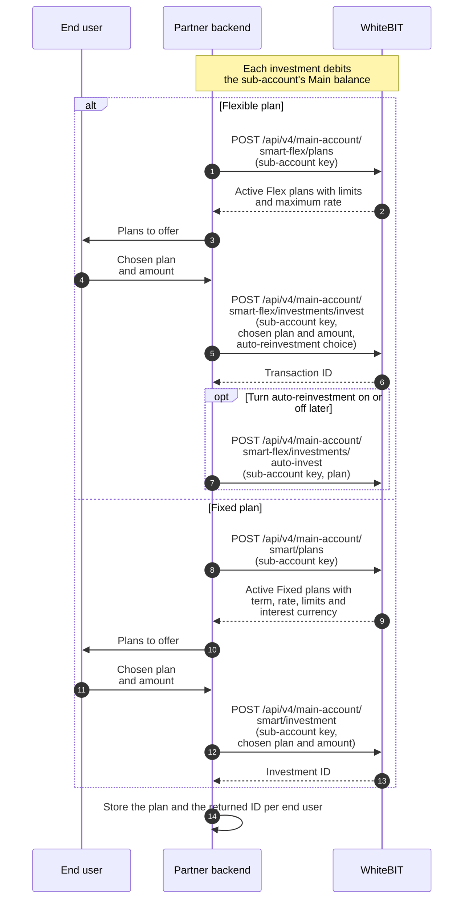
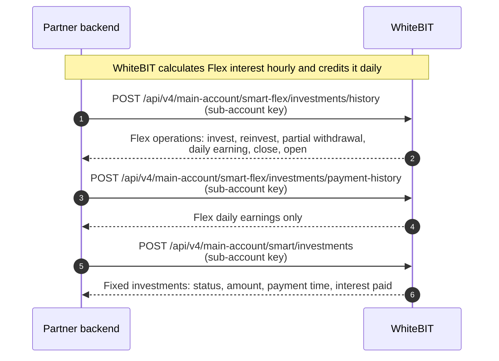
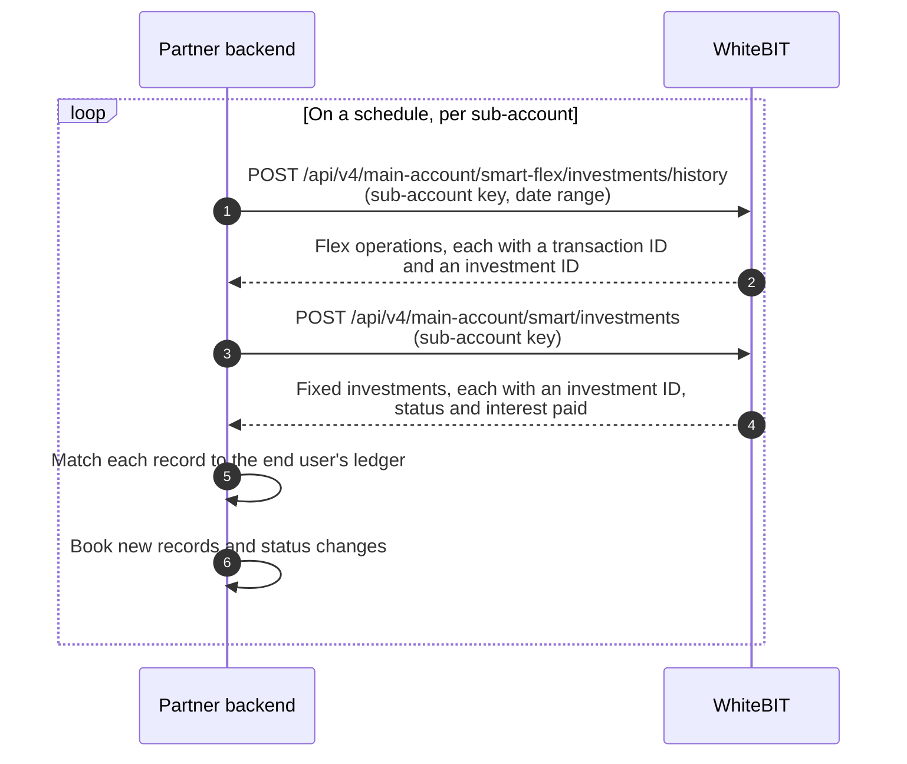
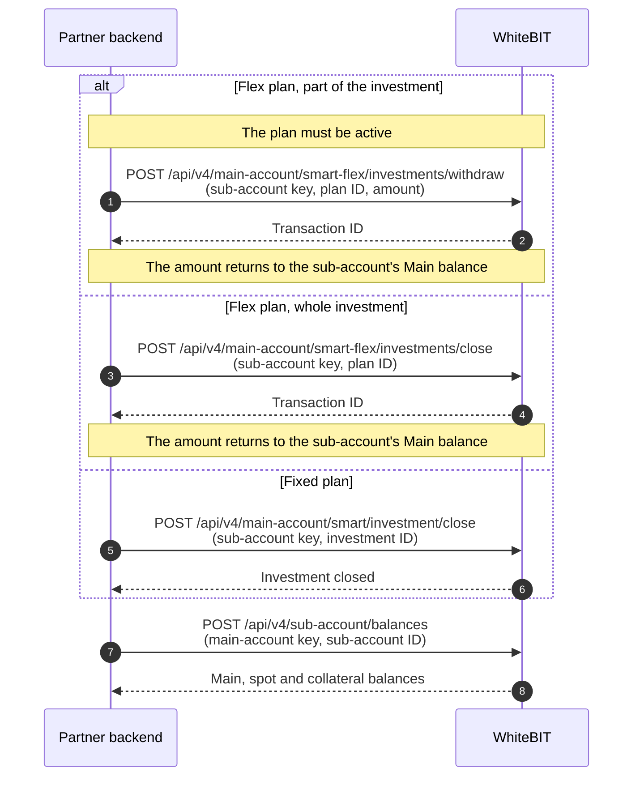
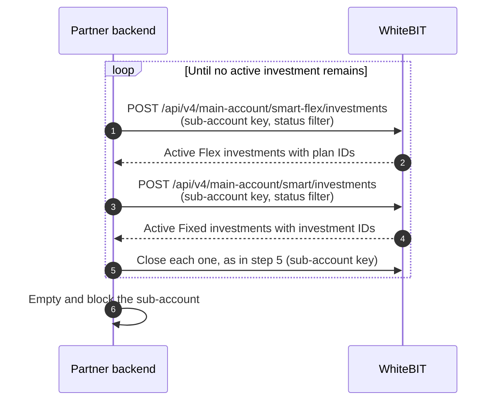

import { RegionBaseUrl } from '/snippets/RegionBaseUrl.jsx';
import KeyCreateNoResponse from '/snippets/text/key-create-no-response.mdx';
import TransferNoIdempotency from '/snippets/text/transfer-no-idempotency.mdx';
import SubAccountOffboarding from '/snippets/diagrams/sub-account-offboarding.mdx';

<Note>
**For developers.** This page covers the technical integration. For what YaaS is, the model, and how
to apply, see the [Yield-as-a-Service overview](/guides/yaas-overview).
</Note>

<RegionBaseUrl />

Yield-as-a-Service uses **Model A** — one [sub-account](/products/sub-accounts/overview) per end
user, with the [Crypto Lending](/products/lending/overview) lifecycle run inside each sub-account
using that sub-account's own API key. This guide covers the B2B layer — provisioning, funding, per-user
reconciliation, redemption, and offboarding. The [Crypto Lending quickstart](/products/lending/quickstart)
documents the Flex lifecycle. The Fixed endpoints are in the API reference linked from the
[Crypto Lending technical overview](/products/lending/overview#technical-overview). Two things differ here: the
signing key (the sub-account's own key) and lending enablement per sub-account.

## Prerequisites

- **Crypto Lending enabled where it runs.** Lending is available on the main account with B2B access; on sub-accounts it is **not enabled by default** — request enablement for each end-user sub-account via the account manager (see the [overview](/guides/yaas-overview#how-to-get-started)). Until it is enabled, the lending endpoints are not available on that sub-account.
- **A sub-account per end user**, each with its own **type:2** API key (info, trading, deposits, withdraws) — type:2 is required to run lending on a sub-account.
- **Funds in the main account's Main balance** to allocate to each sub-account.
- **HMAC-signed requests** — see [Authentication](/api-reference/authentication).

## Integration building blocks

### 1. Provision a sub-account per end user

Create one sub-account per end user and issue that sub-account a type:2 API key. Sign both requests
with the main-account key. Build with [Sub-Accounts](/products/sub-accounts/overview) for account creation
and key management, and the [Embedded Trading integration guide](/guides/sub-account-integration) for
the full walkthrough (per-customer keys, KYC URLs).

| Endpoint | Purpose |
|----------|---------|
| `POST /api/v4/sub-account/create` | Create a sub-account (`alias`, `permissions`, and `email` where the endpoint requires it) |
| `POST /api/v4/sub-account/api-key/create` | Issue the sub-account a key (`type: 2`, `subAccountId`, `title`) |

<KeyCreateNoResponse />

The [14-day deactivation of unused keys](/best-practices/security#key-rotation) applies to sub-account keys too, and any
authenticated request with the key resets the timer. See [API key lifecycle](/guides/waas-integration#api-key-lifecycle).

The partner's backend enrolls each end user with the sub-account and API key steps of WaaS [Wallet creation](/guides/waas-integration#wallet-creation), plus the deposit-address step where the sub-account takes [crypto deposits](/guides/waas-integration#deposits).



### 2. Fund the sub-account

Move funds from the main account's Main balance to the end user's sub-account with a fee-free transfer, signed with
the main-account key.

| Endpoint | Purpose |
|----------|---------|
| `POST /api/v4/sub-account/transfer` | `id` (sub-account), `direction: main_to_sub`, `ticker`, `amount` |

<TransferNoIdempotency />

Run the check with `POST /api/v4/sub-account/transfer/history`, as in WaaS
[Crypto purchases with fiat](/guides/waas-integration#crypto-purchases-with-fiat).

For crypto deposits to a sub-account, the partner's backend polls the deposit history with the sub-account's key, as in the [deposit flow](/guides/waas-integration#deposits). Webhooks are optional.

### 3. Offer yield inside the sub-account

Run the Crypto Lending lifecycle — fetch plans, invest, track, withdraw — signed with the
**sub-account's own key**, so investments and Flex interest stay with that sub-account. The request
and response fields are in the [Crypto Lending quickstart](/products/lending/quickstart) (Flex) and, for Fixed, in
the API reference linked from the [Crypto Lending technical overview](/products/lending/overview#technical-overview).

```bash
# Invest on an end user's behalf — signed with THAT sub-account's type:2 key
curl -X POST https://whitebit.com/api/v4/main-account/smart-flex/investments/invest \
  -H "Content-Type: application/json" \
  -H "X-TXC-APIKEY: SUBACCOUNT_API_KEY" \
  -H "X-TXC-PAYLOAD: PAYLOAD" \
  -H "X-TXC-SIGNATURE: SIGNATURE" \
  -d '{
    "plan": "PLAN_ID",
    "amount": "100.00",
    "withReinvest": true,
    "request": "/api/v4/main-account/smart-flex/investments/invest",
    "nonce": 1709340000000
  }'
```

<Note>
The `main-account/` path segment addresses the **signing account's own Main balance** — for a
sub-account key, that is the sub-account's balance, not the main account's. This is why a sub-account key
runs the lending lifecycle against that end user's funds.
</Note>

| Endpoint | Purpose |
|----------|---------|
| `POST /api/v4/main-account/smart-flex/plans` | Available flexible plans |
| `POST /api/v4/main-account/smart-flex/investments/invest` | Invest on the end user's behalf |
| `POST /api/v4/main-account/smart-flex/investments/withdraw` | Withdraw to the sub-account Main balance |
| `POST /api/v4/main-account/smart/plans` | Available fixed plans |
| `POST /api/v4/main-account/smart/investment` | Invest in a fixed plan on the end user's behalf |
| `POST /api/v4/main-account/smart/investment/close` | Close a fixed investment |

The partner's backend places each investment in a flexible or a fixed plan and signs every call with the sub-account's own key.



### 4. Reconcile earnings per user

Each sub-account's investments and payment history are that end user's earnings. There is no
aggregated cross-sub report, so attribution is per sub-account — read each sub-account with its own key.

An investment debits the sub-account's Main balance (see [Balances](/concepts/balances)), and
`POST /api/v4/sub-account/balances` reports only the main, spot and collateral balances. The partner's backend
reads open investments through the investments endpoints below.

| Endpoint | Purpose |
|----------|---------|
| `POST /api/v4/main-account/smart-flex/investments` | The end user's flexible investments (filter with `investmentStatus`) |
| `POST /api/v4/main-account/smart-flex/investments/history` | Every flexible-plan operation of the end user |
| `POST /api/v4/main-account/smart-flex/investments/payment-history` | Flexible-plan interest credited to the end user |
| `POST /api/v4/main-account/smart/investments` | The end user's fixed investments |
| `POST /api/v4/main-account/smart/interest-payment-history` | Fixed-plan interest payments |

The partner's backend signs each lending call below with the sub-account's own key and gets back only that sub-account's records.



The partner's backend reconciles each sub-account on a schedule against that end user's ledger.



### 5. Redeem investments and pay out

The partner's backend, signing with the sub-account's key, withdraws part of a Flex investment or closes it by
plan ID, and closes a Fixed investment by investment ID.



Early closure of a Fixed investment follows the early-withdrawal terms in
[Crypto Lending plan types](/products/lending/overview#plan-types). From the sub-account's Main balance, the funds follow
the WaaS [payment and payout flows](/guides/waas-integration#payment-and-payout-flows):

- **Fiat payout** — a transfer to the main account, then a payout from the partner's own system, as in
  [Crypto sales for fiat](/guides/waas-integration#crypto-sales-for-fiat).
- **Crypto withdrawal** — created with the sub-account's key and confirmed by the main account, as in
  [Sub-account withdrawal approval](/products/sub-accounts/quickstart#sub-account-withdrawal-approval). Available where
  the account manager has enabled sub-account withdrawals.
- **Payout in another currency** — [Convert](/platform/convert) on the sub-account first, as in
  [Conversion](/guides/waas-integration#conversion).

### 6. Offboard an end user

Invested funds do not show in `POST /api/v4/sub-account/balances` (see
[Reconcile earnings per user](#4-reconcile-earnings-per-user)). Offboarding therefore starts with the sub-account's
key. The partner's backend lists and closes every active investment, then follows
[End-user offboarding](/guides/waas-integration#end-user-offboarding) to empty and block the sub-account. A Fixed
investment closed before maturity follows the early-withdrawal terms in
[Crypto Lending plan types](/products/lending/overview#plan-types). The sub-account's key creates the final withdrawal
and the main account confirms it, as in
[Sub-account withdrawal approval](/products/sub-accounts/quickstart#sub-account-withdrawal-approval). The final
withdrawal is available where the account manager has enabled sub-account withdrawals.



<SubAccountOffboarding />

## Testing

WhiteBIT does not offer a public testnet or sandbox. Test on the live API with minimum amounts, and
check available plans and per-plan minimums via the plans endpoints first.

## Reference

- [Sub-Accounts](/products/sub-accounts/overview) — create and manage per-user accounts and keys.
- [Crypto Lending](/products/lending/overview) — Fixed and Flex plan mechanics, supported assets, and the full endpoint reference.
- [Crypto Lending quickstart](/products/lending/quickstart) — the invest, track, and withdraw lifecycle.

## What's next

<CardGroup cols={3}>
  <Card title="FAQ" icon="circle-question" href="/guides/yaas-faq">
    How B2B yield differs from the single-account flow.
  </Card>
  <Card title="Crypto Lending" icon="piggy-bank" href="/products/lending/overview">
    Plan mechanics, supported assets, and the endpoint reference.
  </Card>
  <Card title="Sub-Accounts" icon="sitemap" href="/products/sub-accounts/overview">
    Create and manage the per-user accounts this program provisions.
  </Card>
</CardGroup>
