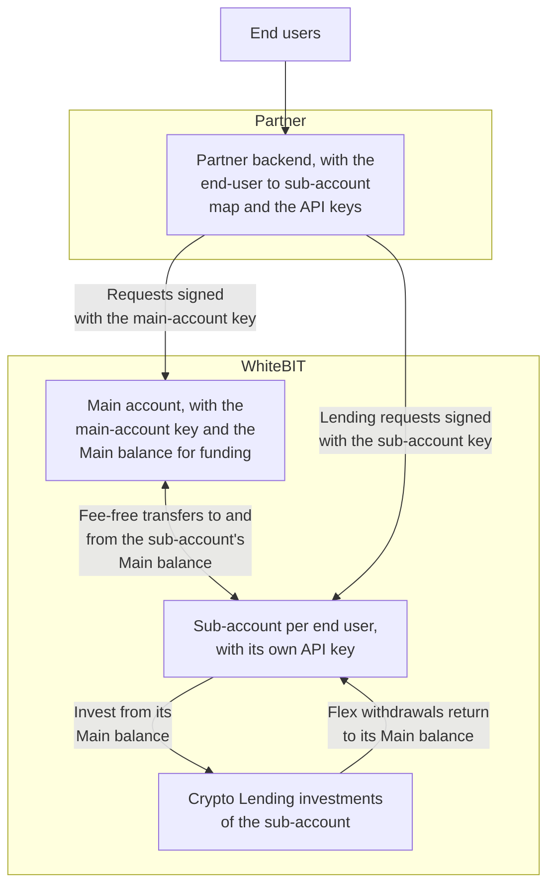

import PartnerEligibility from '/snippets/partner-eligibility.mdx';

Yield-as-a-Service (YaaS) lets a partner offer WhiteBIT [Crypto Lending](/products/lending/overview)
yield to end users through the API. This overview covers fit and the integration
model. For the technical build, see the [Integration guide](/guides/yaas-integration).

<Tip>
The [Crypto Lending](/products/lending/overview) product pages describe the earn capability itself —
plan types, supported assets, and the endpoint reference. This program covers how a partner delivers
that capability to many end users.
</Tip>

## What Yield-as-a-Service provides

- Fixed-term and flexible yield plans, offered to end users through the API ([Crypto Lending](/products/lending/overview)).
- Per-user segregation: each end user earns in a dedicated [sub-account](/products/sub-accounts/overview), with independent balances and history.
- Full lifecycle control — present plans, invest on an end user's behalf, track earnings, and withdraw from investments to the sub-account balance — all programmatic.
- Auto-reinvestment for compounding on flexible plans.

## Who Yield-as-a-Service is for

- **Fintechs, wallets, and neobanks** — add an earn feature for end users without building a yield engine, custody, or risk management.
- **Exchanges and brokers** — offer yield on idle customer balances alongside trading.

## Architecture

YaaS uses **Model A**: the partner operates one [sub-account](/products/sub-accounts/overview) per
end user under a main account, and runs the lending lifecycle inside each sub-account using that
sub-account's own API key. Funds, investments, and interest stay segregated per user; the main
account acts as the funding hub. Endpoint mechanics are on the
[Integration guide](/guides/yaas-integration).

The partner's backend signs the main account's requests with the main-account key and each sub-account's lending requests with that sub-account's own key.

<Note>
For yield, a single pooled (omnibus) account for end-user funds is not offered. Each end user's yield sits in
its own sub-account. See [Integration models](/concepts/integration-models).
</Note>

## Program terms

Crypto Lending access is approval-gated and assessed during KYB. It is available on the main
account, and **enabled per sub-account on request** — sub-accounts do not have lending enabled by
default. Commercial terms are agreed per contract during onboarding.

<PartnerEligibility />

## How to get started

1. Complete KYB as part of [Institutional Onboarding](/institutional/onboarding).
2. Request Crypto Lending enablement via the account manager — for the main account, and for each sub-account that will offer yield.
3. Build the integration — see the [Integration guide](/guides/yaas-integration).

## What's next

<CardGroup cols={3}>
  <Card title="Integration" icon="code" href="/guides/yaas-integration">
    Provision sub-accounts, invest on an end user's behalf, and reconcile earnings.
  </Card>
  <Card title="FAQ" icon="circle-question" href="/guides/yaas-faq">
    How B2B yield differs from the single-account flow.
  </Card>
  <Card title="Crypto Lending" icon="piggy-bank" href="/products/lending/overview">
    The earn capability this program builds on.
  </Card>
</CardGroup>
